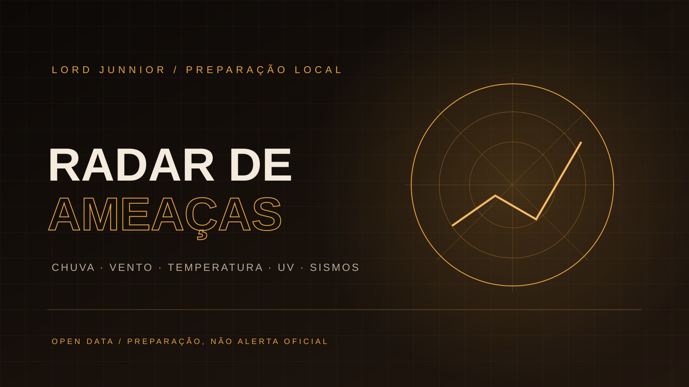

<div align="center">



# RADAR DE AMEAÇAS

**Transforme previsões públicas em preparação prática.**

[](https://react.dev/)
[](https://www.typescriptlang.org/)
[](https://vite.dev/)
[](./LICENSE)

</div>

---

## Visão geral

Radar de Ameaças consulta a previsão para os próximos sete dias e resume indicadores que podem exigir preparação: chuva, vento, calor, frio, índice UV e atividade sísmica recente.

A aplicação combina dados meteorológicos e geocodificação do Open-Meteo com eventos sísmicos do USGS. O resultado é um painel de apoio à preparação doméstica, não um sistema oficial de alerta ou previsão de desastres.

## Indicadores

- Precipitação diária máxima prevista.
- Rajadas de vento.
- Temperaturas máximas e mínimas.
- Índice UV.
- Maior evento sísmico retornado num raio de até 500 km nos últimos 30 dias.
- Lista prática de itens e ações para preparação.

## Fontes

- [Open-Meteo Forecast API](https://open-meteo.com/en/docs) — previsão meteorológica.
- [Open-Meteo Geocoding API](https://open-meteo.com/en/docs/geocoding-api) — busca de localidades.
- [USGS Earthquake Catalog](https://earthquake.usgs.gov/fdsnws/event/1/) — eventos sísmicos.

## Privacidade

O nome da cidade informado é enviado ao serviço de geocodificação do Open-Meteo. As coordenadas retornadas são usadas nas consultas de previsão e no catálogo sísmico do USGS. Não há cadastro, conta ou coleta própria de localização.

## Limites importantes

- As faixas exibidas são critérios informativos do aplicativo, não níveis oficiais de defesa civil.
- A previsão muda conforme novas atualizações dos provedores.
- A ausência de eventos sísmicos na resposta não garante ausência de atividade.
- Em emergências, siga os alertas e as orientações das autoridades locais.

## Executar localmente

Requisitos: Node.js 20+ e npm.

```bash
npm install
npm run dev
npm test
npm run build
```

## Estrutura

```text
src/
├── App.tsx
├── SovereignKit.tsx
├── sovereign-suite.css
├── index.css
├── main.tsx
└── lib/
    ├── public-radar.ts
    └── public-radar.test.ts
```

## Autoria

Projeto independente de **Lord Junnior**.
